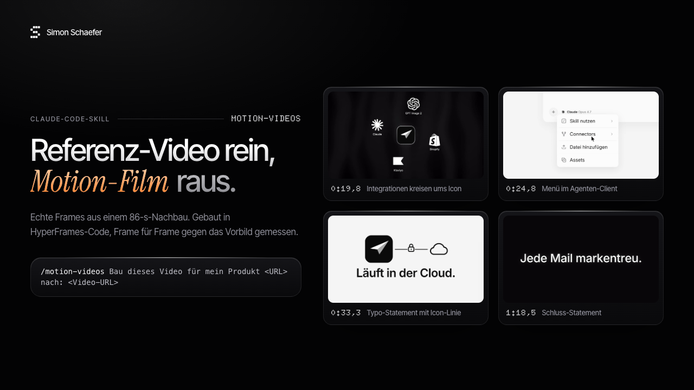

# motion-videos



*Ich wollte ein Produkt-Reel nachbauen, das mir gefiel, und habe es zuerst mit einem Videogenerator versucht. Die Texte zerfielen, jeder Clip kostete Geld, und das Timing stimmte nie. Was am Ende funktioniert hat: das Vorbild Frame für Frame vermessen, UI und Text als Code bauen, nur echtes Footage generieren und vor jedem bezahlten Schritt fragen. Dieser Skill ist genau dieser Ablauf. Simon Schaefer, Oktober 2026*

Die Idee: Ein Referenz-Video ist die Spezifikation. Claude holt es anonym, zerlegt es in Frames und Ton, lässt Vision-Agenten jeden Shot beschreiben (Layout, Typo, Easing, Kamera, Schnitt-Frame) und lässt die Tonspur über Gemini beschreiben (Musik, BPM, Effekt-Palette, Event-Karte). Danach wird jeder Beat auf eine echte Funktion deines Produkts gemappt, mit Beleg. Gebaut wird in [HyperFrames](https://hyperframes.heygen.com) (HTML/CSS/GSAP → MP4): erst eine 10-Sekunden-Probe, die frame-genau gegen die Referenz gemessen wird, dann Blöcke parallel. Bild-, Video-, Musik- und Effekt-Generatoren kommen nur für echtes Footage zum Einsatz, über den Anbieter, den du angeschlossen hast. Vor jeder kostenpflichtigen Generierung zeigt Claude die Prompts wörtlich, den Referenz-Ordner und die Kosten und wartet auf dein „Go“.

## How it works

- **`SKILL.md`**: der Ablauf in zehn Phasen mit sechs Gates (Referenz, Blueprint, Generierung, Probe, Ton, Abnahme). Claude liest ihn, du nicht.
- **`references/`**: die Tiefe je Phase, von der Gate-Frageliste bis zu den Fallstricken aus echten Läufen.
- **`scripts/hole-referenz.sh`**, **`vergleich.py`**, **`bewegung.py`**, **`ton-referenz.mjs`**: Referenz holen, Probe gegen Referenz messen (Schnitte auf den Frame, Seite-an-Seite-Video, Kontaktbögen), Standbilder finden, Ton beschreiben.
- **`motion-runs/<datum>_<slug>/`** in deinem Projekt: hier entsteht alles, mit einem `MANIFEST.md`, das Entscheidungen, Kosten und Freigaben festhält.

Die eine Konstante: Code für UI und Text, Generierung nur für Footage.

## Quick start

**Voraussetzungen:** macOS oder Linux, Node 18+, Python 3, ffmpeg, yt-dlp, ein [Gemini-API-Key](https://aistudio.google.com/apikey). Was fehlt, sagt dir das Install-Skript.

```bash
# 1. Klonen und global installieren (in allen Projekten verfügbar)
git clone https://github.com/simon-schaeferai/motion-videos ~/.claude/skills/motion-videos
bash ~/.claude/skills/motion-videos/install.sh --global

# 2. Gemini-Key eintragen
open -e ~/.claude/skills/motion-videos/.env      # GEMINI_API_KEY=...

# 3. Prüfen
bash ~/.claude/skills/motion-videos/scripts/setup_check.sh
```

Nur für ein Projekt: im Projekt-Ordner `git clone https://github.com/simon-schaeferai/motion-videos .claude/skills/motion-videos` und `bash .claude/skills/motion-videos/install.sh --projekt`. Wenn der Check „Alles bereit“ meldet, Claude Code neu starten. Details, Fehlerbilder und Modellwahl stehen in [SETUP.md](SETUP.md).

## Using it

```
/motion-videos Bau dieses Video für mein Produkt https://mein-produkt.de nach: https://www.youtube.com/watch?v=...
```

Claude stellt zuerst die Gate-Fragen (Ziel, Absender, Format, Sprache, Demo-Inhalt, welche Generatoren angeschlossen sind) und arbeitet danach Phase für Phase. Du gibst an den Gates frei, lieferst Logos oder Screens und hörst den Ton ab.

## Design choices

- **Referenz messen statt nachempfinden.** Schnitte, Easing und Kamera-Stufen werden aus den Frames gemessen und die Probe wird gegen dieselben Frames geprüft. Das kostet am Anfang Zeit (Analyse und Probe dauern länger als ein schneller Entwurf), dafür stimmt das Tempo am Ende.
- **HyperFrames-Code statt Videogenerator für UI und Text.** Text bleibt scharf, jede Änderung ist ein Edit statt eines neuen bezahlten Clips. Der Nachteil: Echte Menschen, Produkte und Umgebungen brauchen trotzdem einen Generator oder eigenes Material.
- **Gates im Chat statt Automatik.** Nichts Kostenpflichtiges läuft ohne dein „Go“, und unbelegte Produktfunktionen werden gefragt statt erfunden. Das bremst, verhindert aber teure Fehl-Renders und unwahre Produktfilme.
- **Anbieter-neutral.** Der Skill nennt Empfehlungen (z. B. GPT Image 2 für Produktbilder, Lyria für Musik, ElevenLabs für Effekte), nutzt aber, was du angeschlossen hast. Ohne Generator gibt es eine Code-only-Route mit deinen eigenen Assets.
- **Gemini direkt für den Ton.** Claude kann nicht hören. Ein video-fähiges Gemini-Modell beschreibt die Tonspur, damit der Nachbau ähnlich klingt statt nur ähnlich getaktet zu sein. Abnehmen musst du ihn trotzdem selbst.

## Limitations

- Claude hört den fertigen Ton nicht. Die Mischung wird gemessen (Lautheit, Energiekurve, Cue-Timing), der Höreindruck bleibt bei dir.
- Generierung kostet Geld beim jeweiligen Anbieter; die Kosten stehen vor jedem Go im Chat und danach im Manifest.
- Login-pflichtige oder private Videos lädt der Skill nicht (kein Cookie-Umweg). Dann die Datei selbst herunterladen und übergeben.
- Lizenzen bleiben deine Aufgabe: Musik aus Bibliotheken, generierte Musik je nach Anbieter-Plan, fremde Logos nur für echte Integrationen.
- Kundenmarken und echte Kundendaten brauchen eine schriftliche Freigabe. Ohne sie baut der Skill mit einer Demo-Marke.
- Ein 1:1-Nachbau eines fremden Marken-Films ist nur als interne Studie gedacht, nicht zur Veröffentlichung.

## License

MIT
